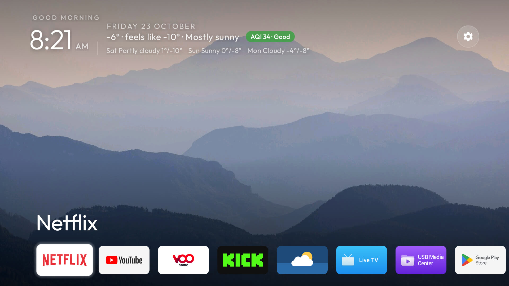
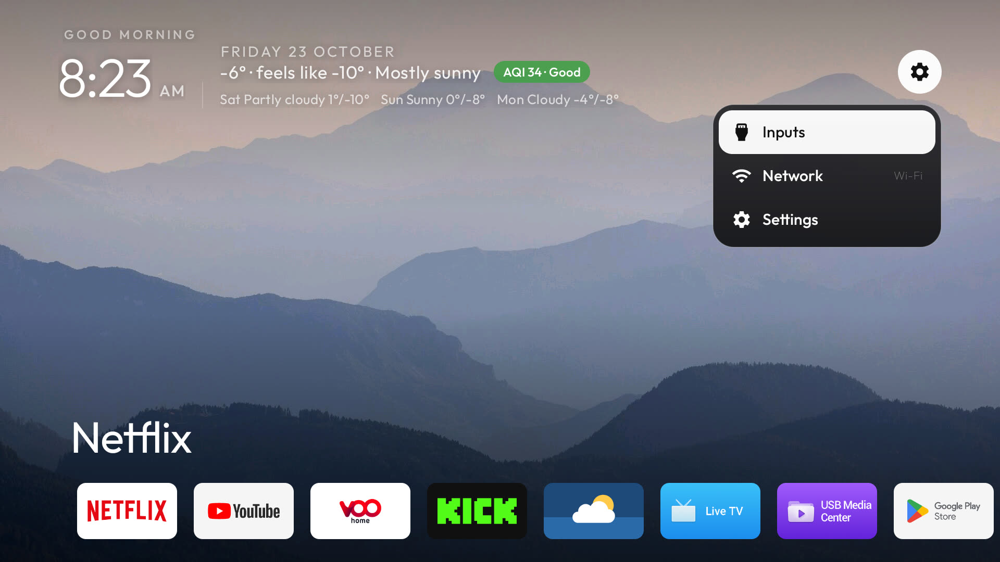
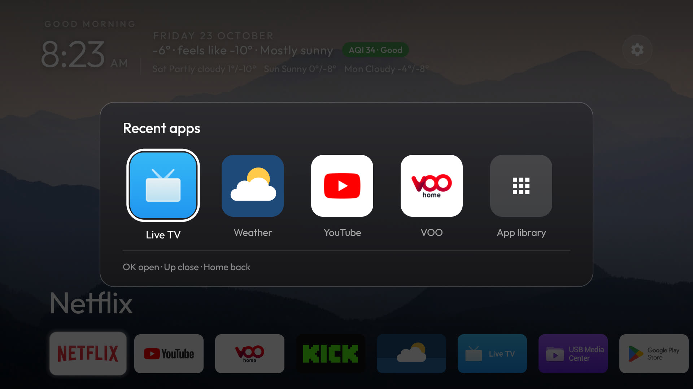

# cleanyourtv on a Hisense SmartTV 4K FFM

This branch is [cleanyourtv](https://github.com/Gathin23/cleanyourtv)'s launcher as it runs on one Hisense
set in Ulaanbaatar: one row of apps along the bottom, a Google TV style gear, the weather and the air
quality under the clock, and a Recent apps screen on the remote's Apps button.



| The gear | Recent apps |
|---|---|
|  |  |

Wallpaper in the screenshots: [Marek Piwnicki](https://unsplash.com/photos/-_OuVFhN5BU) on Unsplash. The
photos themselves are not in this branch; bring your own.

**Tested on:** Hisense SmartTV 4K FFM (board `lushan`, MediaTek MT9676), Google TV 12 / Android 12, with the
Bluetooth SmartRC remote. The debloat list for this set is in upstream's
[`examples/hisense-smarttv-4k-ffm-lushan/`](https://github.com/Gathin23/cleanyourtv/tree/main/examples/hisense-smarttv-4k-ffm-lushan).

## What it changes

- **One row of apps** at the bottom, every app in it, scrolling off the screen edge (`dock_scroll`), with only
  the top and bottom of the wallpaper shaded. Sent upstream as [#864](https://github.com/Gathin23/cleanyourtv/pull/864).
- **One gear** instead of the Inputs, Wi-Fi and Settings pills; OK drops a menu with the three (`top_menu`).
  Merged upstream in [#863](https://github.com/Gathin23/cleanyourtv/pull/863).
- **Weather under the date:** the temperature, feels-like and the sky now, a US AQI pill coloured by its band,
  and the next three days. From Open-Meteo with DWD's ICON model, which matched Google's weather here
  better than the default blend, and rain at a wet-bulb temperature of 1 °C or below shown as snow, as it
  falls in a dry Mongolian winter. The same weather is also upstream as the
  [Weather add-on](https://github.com/Gathin23/cleanyourtv/tree/main/addons/weather).
- **Recent apps** on the remote's Apps button: the apps used in the last day, newest first, with the App
  library at the end.
- **Remote buttons:** YouTube opens YouTube (scancode 469), HDMI switches to the HDMI input (362), Subtitle
  opens the TV's captions settings, and the Netflix tile opens Netflix's TV shows.
- Seven tiles across, and a dock of Netflix, YouTube, VOO home and Kick.

## Network and permissions

| Permission | Why |
|---|---|
| `INTERNET` | The weather. The launcher sends the latitude and longitude in `config.xml` to `api.open-meteo.com` and `air-quality-api.open-meteo.com` every 30 minutes while Home is on screen, and nothing else. Empty coordinates turn it off. |
| `PACKAGE_USAGE_STATS` | Recent apps: which apps were opened in the last day. Granted with `appops`, read on the TV only. |
| `KILL_BACKGROUND_PROCESSES` | Closing an app from Recent apps, and starting an app fresh from a remote button (YouTube otherwise reopens on the screen it was left on). |

No accounts, no analytics, no other servers.

## Build and install

Set your own place in `launcher/app/src/main/res/values/config.xml` (`latitude`, `longitude`; empty for no
weather) and your dock apps, then, with ADB over Wi-Fi on the TV:

```bash
INPUT_KEY_SERVICE=1 TV_HOST=192.168.1.50 launcher/build-and-install.sh
TV_HOST=192.168.1.50 tools/theme.sh themes/hisense-ffm
adb shell appops set com.gathin.tvhome GET_USAGE_STATS allow   # for Recent apps
```

`INPUT_KEY_SERVICE=1` turns on the accessibility service that handles the remote buttons. Add a
`wallpaper.jpg`, or a `wallpapers/` folder with `"wallpaper": true` in `config.json`, to the theme for a
picture behind Home.

## By

[@Sumyabazar1](https://github.com/Sumyabazar1). Issues for this branch go to
[Sumyabazar1/cleanyourtv](https://github.com/Sumyabazar1/cleanyourtv/issues).
